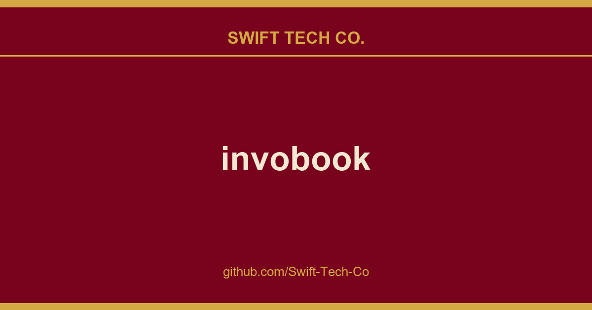

# invobook

## What This Is

This is part of the Swift Tech Co. working stack for product and engineering. It gathers the invobook notes, examples and fixes that keep delivery fast, and doubles as the reference map we hand to whoever picks up this thread next.

## Images

[](https://github.com/Swift-Tech-Co/invobook)

## Hire me

## About Invobook

Invobook is a self-hosted app to manage team/clients, project & tasks, time tracking, create and sending invoice and more. It is build upon Filament and TALL stack.

<hr>
<p align="center">
<b><a href="#installation">Installation</a></b>
|
<b><a href="#screenshots-top">Screenshots</a></b>
|
<b><a href="#contributing-top">Contributing</a></b>
|
<b><a href="#supporting-top">Supporting</a></b>
|
<b><a href="#credits-top">Credits</a></b>
|
<b><a href="#license-top">License</a></b>
</p>

<hr>

## Installation

Clone the repository

```sh
git clone git@github.com:Hasnayeen/invobook.git
```

Set env variables

```sh
cp .env.example .env
```

Install composer packages

```sh
composer install
```

## Screenshots <small>[↑Top](#about-invobook)</small>


## Contributing <small>[↑Top](#about-invobook)</small>

To contribute telegram [link](https://t.me/+Qt_eFvkb2rliMzNh)

## Supporting <small>[↑Top](#about-invobook)</small>

### Professional Support

## Security Vulnerabilities <small>[↑Top](#about-invobook)</small>

## Credits <small>[↑Top](#about-invobook)</small>

- Author: Nehal Hasnayeen (https://github.com/Swift-Tech-Co/invobook)

- Full Contributors List

## License <small>[↑Top](#about-invobook)</small>

Invobook is open-sourced software licensed under the MIT license.

---

## Swift Tech Co.

Built and maintained by Swift Tech Co.

AI Automation | FinTech Platforms | Custom Software and Mobile Apps | SaaS Platforms | Cloud Infrastructure | Cybersecurity | SEO and Marketing | API Integration

**Join our community on Telegram:** [t.me/+Qt_eFvkb2rliMzNh](https://t.me/+Qt_eFvkb2rliMzNh)

Home | Services | Careers | Referral Program | Influencers | About | Contact

**Connect**

- Website: https://github.com/Swift-Tech-Co/invobook
- LinkedIn: [linkedin.com/in/stephenoladoke](https://www.linkedin.com/in/stephenoladoke/)
- LinkedIn (Company): [linkedin.com/company/swift-tech-co](https://www.linkedin.com/company/swift-tech-co)
- X: [@MrOladoke](https://x.com/MrOladoke)
- Instagram: [@mr.oladoke](https://www.instagram.com/mr.oladoke/)
- Instagram (Company): [@swifttechco](https://www.instagram.com/swifttechco/)
- Organization: [github.com/Swift-Tech-Co](https://github.com/Swift-Tech-Co)

## Sources

Compiled and maintained from upstream [Hasnayeen/invobook](https://github.com/Hasnayeen/invobook) under permissive open-source license.

---

Maintained by [Swift Tech Co.](https://github.com/Swift-Tech-Co) - [Telegram](https://t.me/+Qt_eFvkb2rliMzNh)

## Sources

Compiled and maintained from upstream [Hasnayeen/invobook](https://github.com/Hasnayeen/invobook) under permissive open-source license.

---

Maintained by [Swift Tech Co.](https://github.com/Swift-Tech-Co) - [Telegram](https://t.me/+Qt_eFvkb2rliMzNh)